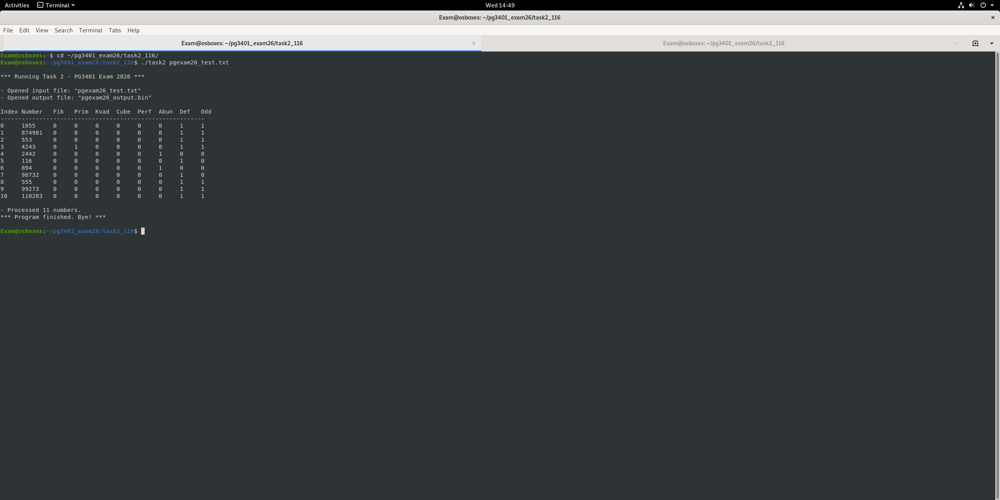
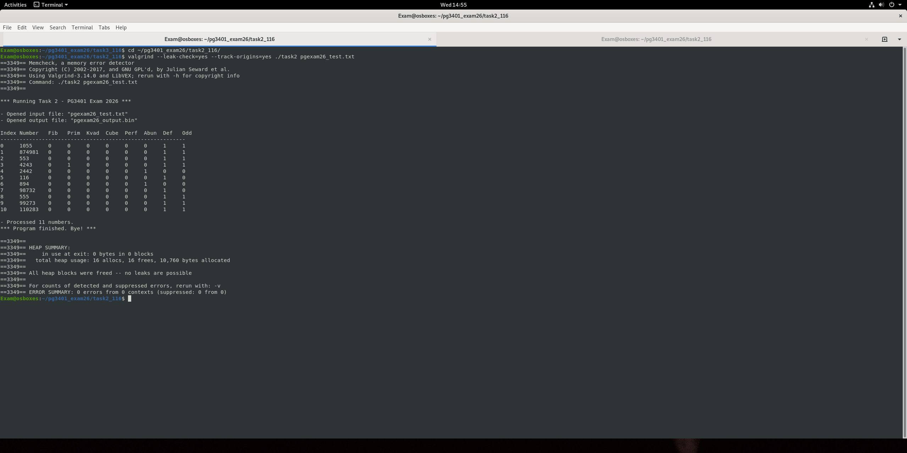

# 01 Number classifier

Reads integers from a text file, runs each one through eight classification functions and writes the results to a binary file.

For every number the program checks if it is a Fibonacci number, prime, perfect square, perfect cube, perfect number, abundant, deficient and odd. The results are stored in a struct and written to `output.bin`, while a table is printed to the terminal.

## Usage

```bash
make
./task2 test_numbers.txt
```

## What I practised

* Linking several `.c` files with a makefile and a shared header
* Reading text input and writing a fixed size binary record per number
* Cleaning up every allocation and file handle on all exit paths

## Screenshots



