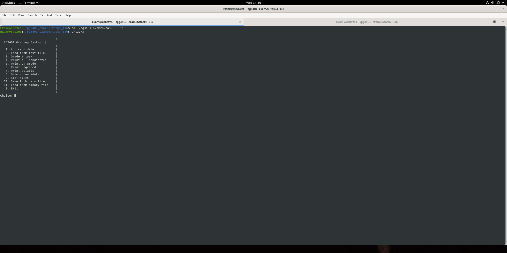
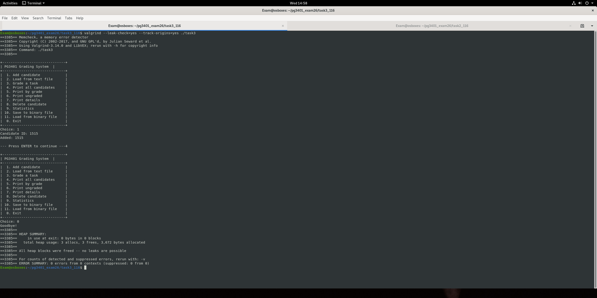

# 02 Grading system

A menu-driven command line app for registering students, grading tasks and calculating letter grades (A to F). Students are stored in a singly linked list on the heap.

## Features

* Add students manually or load a list from a text file
* Grade individual tasks with a written justification
* Print all students, filter by grade or list students with ungraded tasks
* Statistics (count, average, highest and lowest score)
* Delete students
* Save and load the full list to and from a binary file

## Usage

```bash
make
./task3
```

## What I practised

* Linked list insert, search and delete with correct `free()` of every node
* Safe input handling with `fgets` instead of `scanf`
* Binary serialisation of structs

## Screenshots



