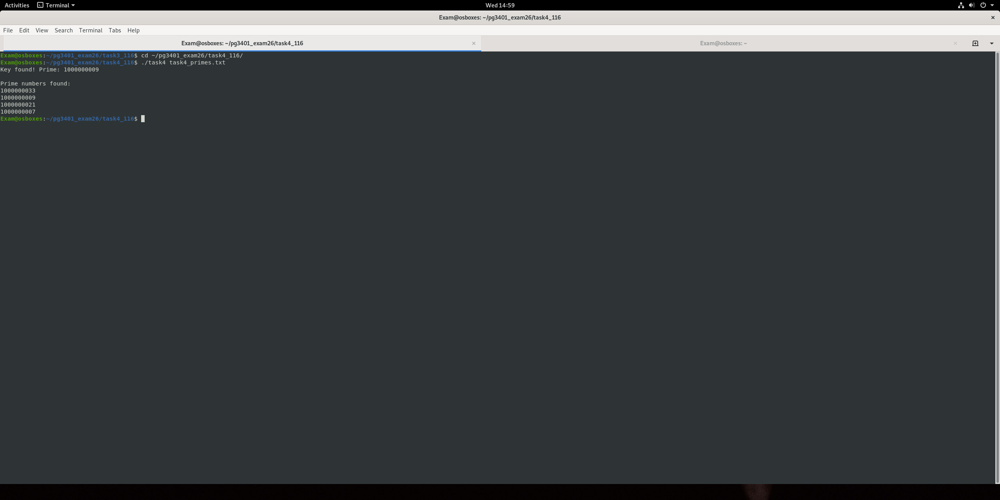
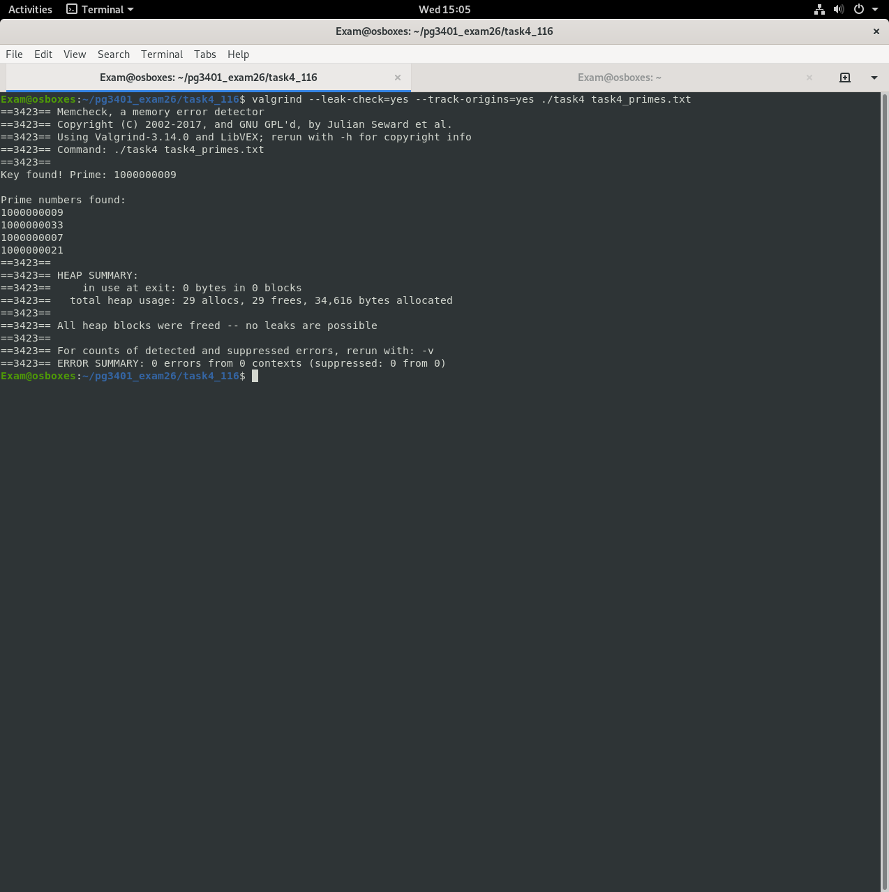

# 03 Trådbasert primtallsdekryptering

To POSIX-tråder jobber sammen for å finne primtall i en fil og bruke dem som nøkler for å dekryptere en XTEA-kryptert melding. Når riktig nøkkel er funnet, lagres klarteksten sammen med en sjekksum av den.

## Slik fungerer det

1. Begge trådene leser fra den samme inndatafilen og deler en lenket liste med primtallene som er funnet så langt
2. Hvert primtall prøves som XTEA-nøkkel på `task4_code.bin`
3. Når den dekrypterte teksten starter med forventet header, lagres den med en sjekksum i TCP-stil, og den andre tråden får beskjed om å stoppe
4. All delt tilstand (filpeker, primtallsliste, funnet-flagg) er beskyttet av en mutex, og sendes til trådene i en struct i stedet for som globale variabler

## Bruk

```bash
make
./task4 task4_primes.txt
```

## Hva jeg øvde på

* `pthread_create`, `pthread_join`, `pthread_mutex_init` / `lock` / `unlock`
* Å unngå kappløpssituasjoner (race conditions) på en delt `FILE *` og en delt liste
* Symmetrisk dekryptering med XTEA, 8 byte om gangen

## Skjermbilder



