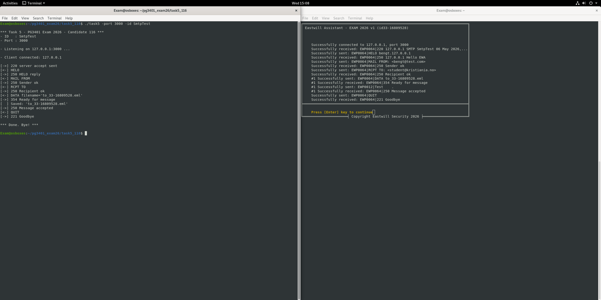
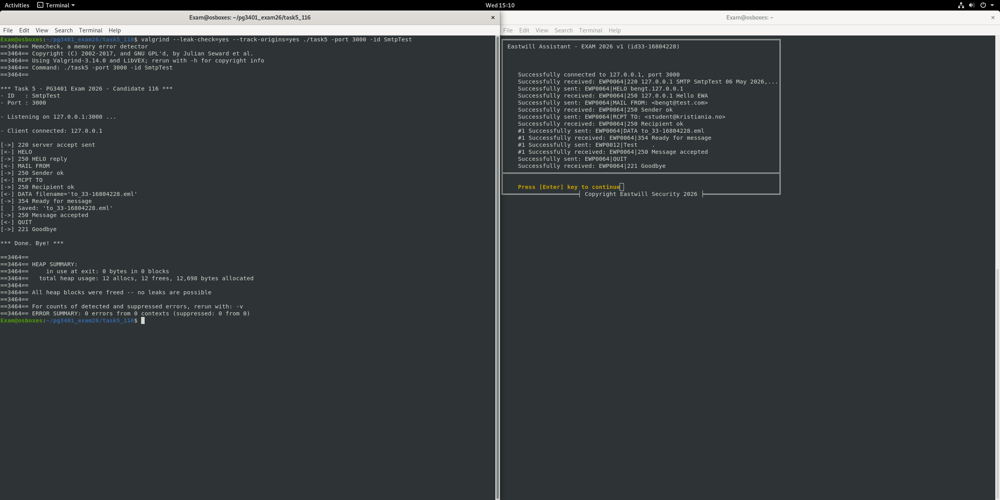

# 04 SMTP server

A small SMTP style mail server over TCP. It listens on localhost, walks a client through the SMTP conversation and saves the received message as an `.eml` file.

Messages are wrapped in a simple binary protocol (EWP): a header with a magic number and the payload size, followed by a fixed size struct for each command or reply. The protocol definitions are in `include/ewpdef.h`.

## Session flow

```
S: 220 <ip> SMTP <server id> <timestamp>
C: HELO <domain>          S: 250 Hello
C: MAIL FROM:<sender>     S: 250 Sender ok
C: RCPT TO:<recipient>    S: 250 Recipient ok
C: DATA <filename>        S: 354 Ready for message
C: <message body>         S: 250 Message accepted
C: QUIT                   S: 221 Goodbye
```

## Usage

```bash
make
./task5 -port 3000 -id SmtpTest
```

## What I practised

* `socket`, `bind`, `listen`, `accept`, `send`, `recv`
* Parsing a fixed binary header and validating sizes before reading the payload
* Server side protocol state handling and safe file names for saved messages

## Screenshots



