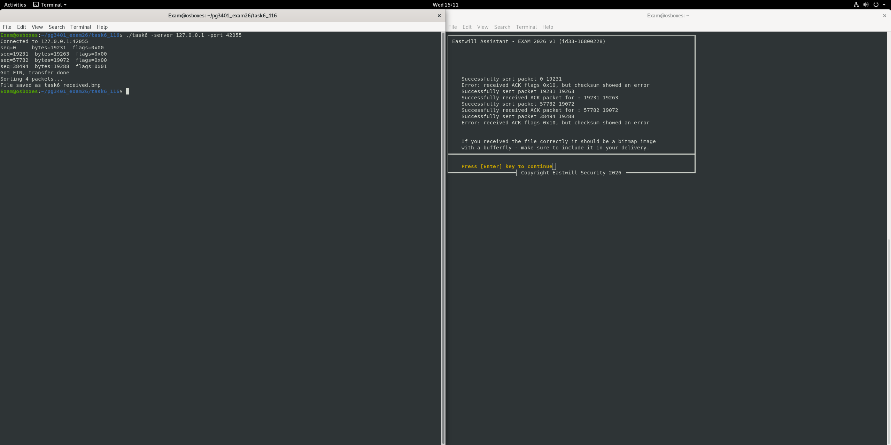
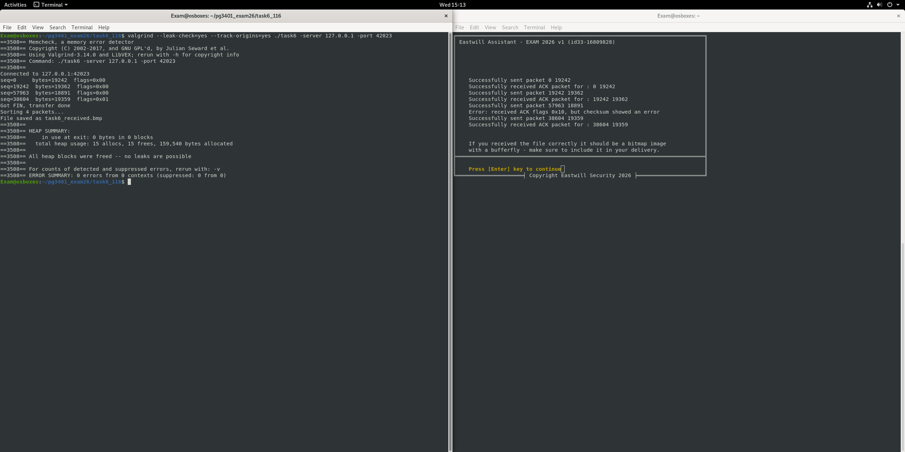

# 05 TCP-filmottaker

En TCP-klient som laster ned et bitmap-bilde som sendes i flere pakker, i feil rekkefølge, med en egen header. Den kvitterer for hver pakke, setter dem i riktig rekkefølge etter sekvensnummer og skriver hele filen til disk.

## Slik fungerer det

1. Koble til serveren som oppgis med `-server` og `-port`
2. Les den faste headeren først, og alloker og les deretter nøyaktig så mye innhold som oppgitt
3. Send ACK (eller NACK) tilbake for hver pakke
4. Stopp når en pakke med FIN-flagget kommer
5. Sorter pakkene etter sekvensnummer og skriv `task6_received.bmp`


## Bruk

```bash
make
./task6 -server 127.0.0.1 -port 42009
```

## Hva jeg øvde på

* En pålitelig `recvAll`-løkke, siden TCP kan dele data over flere `recv`-kall
* Å bygge headere i TCP-stil med sekvensnumre, flagg og sjekksummer
* Å sette sammen data som kommer i feil rekkefølge

## Skjermbilder



